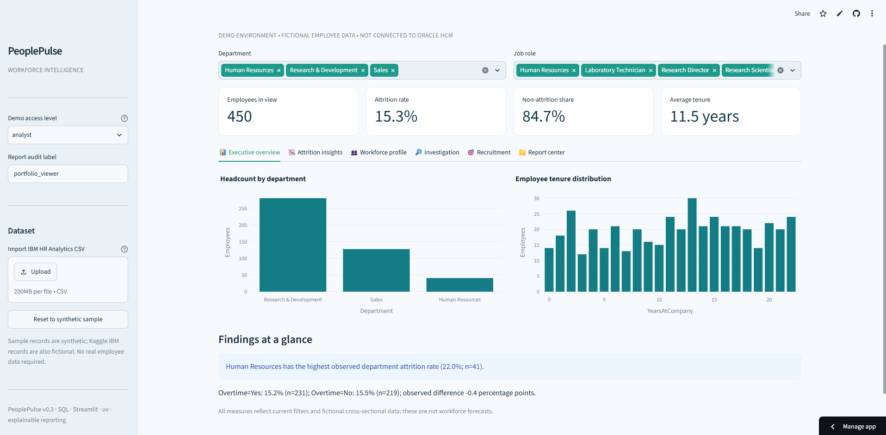
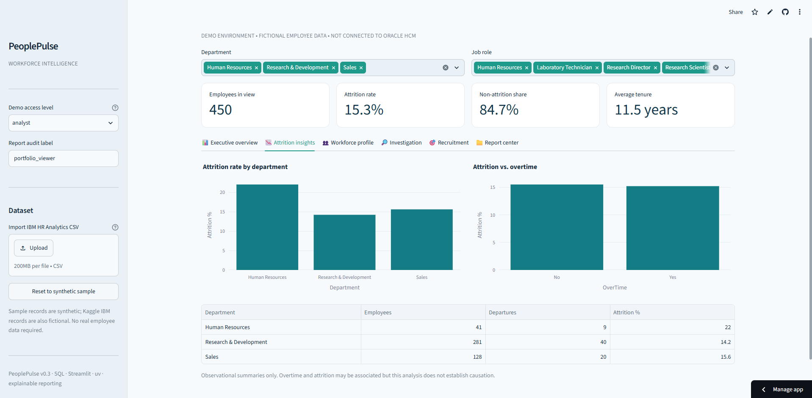
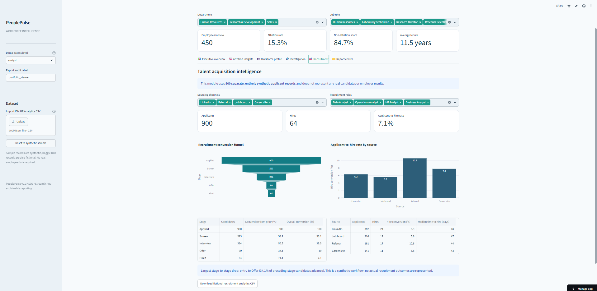

# PeoplePulse · Workforce Intelligence & Recruitment Analytics


## Live Dashboard

[Explore PeoplePulse — Interactive HR Analytics Dashboard](https://peoplepulse-analytics.streamlit.app/)

PeoplePulse is an interactive workforce intelligence platform featuring HR reporting, recruitment funnel analysis, attrition investigation, and data-driven insights.

## Dashboard Preview

### Executive Overview


### Attrition Investigation


### Recruitment Intelligence


**Portfolio project | Python · SQL · Streamlit · Plotly · pandas · SciPy · uv**

PeoplePulse turns fictional HR and recruitment records into reproducible, understandable workforce insights. It combines **data ingestion, SQL reporting, statistical exploration, recruitment funnel analysis, interactive dashboards, exportable reports and automated tests** in one application.

> **Privacy and provenance:** All demo employee and applicant records are *synthetic*. You can optionally import the publicly available **fictional** [IBM HR Analytics Employee Attrition & Performance](https://www.kaggle.com/datasets/pavansubhasht/ibm-hr-analytics-attrition-dataset) CSV (1,470 rows). The recruitment module uses a **separate synthetic event dataset**; it is not extracted from IBM. There is no connection to Oracle HCM, OTBI or BI Publisher. This project must not be used for real employee data.

## Why this project exists

**Business problem:** HR teams often need consistent metrics and an explanation of workforce patterns, not disconnected charts. PeoplePulse answers questions such as:

- How do headcount, attrition and tenure vary by department and role?
- Is observed attrition different for overtime versus non-overtime groups, and what is the sample size?
- Which recruitment stages lose the most candidates, and which sourcing channels show better conversion?
- Can reports be regenerated, checked and exported using traceable analytical logic?

## Product capabilities

| Page | What it demonstrates |
| --- | --- |
| Executive Overview | Cross-filtered KPIs, headcount, tenure and evidence-based summary |
| Attrition Insights | Department and overtime comparisons with explicit denominators |
| Workforce Profile | Role composition, tenure and job satisfaction |
| Analytical Investigation | Rates by group, Wilson 95% intervals, group-size threshold, chi-square (only with adequate expected counts), 8 quality checks, downloadable methodology |
| Recruitment Intelligence | Separate 900-record synthetic funnel, source conversion, hired-candidate median time to hire, bottleneck summary |
| Report Center | Five SQL query templates, CSV export, simulated compensation restrictions, report audit history |

### Analytical method

- **Outcome:** Attrition rate = employees marked `Attrition=Yes` divided by the total group count.
- **Uncertainty:** Wilson 95% binomial intervals are shown alongside rates. This does **not** make fictional records representative of actual workforce trends.
- **Overtime:** Compare rates and show observed percentage-point difference. The unadjusted chi-square p-value is shown only if expected cell counts meet the threshold.
- **Recruitment:** Cumulative funnel counts and stage-to-stage conversion rates use the correct previous-stage denominators; median time to hire is based on hires only.
- **Quality assurance:** Check nonmissing unique employee IDs, valid labels and numeric ranges.
- **Interpretation:** Observational fictional records cannot identify causal effects, realistic prevalence, seasonal trends, actual savings or organizational outcomes.

Read the generated [attrition case study](docs/ATTRITION_CASE_STUDY.md). The included analysis uses the **450-row synthetic demo**; importing the IBM dataset and rerunning the analysis will produce different findings.

## Architecture

```text
Source: synthetic HR CSV or fictional Kaggle IBM HR CSV
     │
     ▼
Python CSV validation  ──► SQLite employee table
                              │
                  ┌───────────┼──────────────┐
                  ▼           ▼              ▼
            Saved SQL    pandas / SciPy   Quality checks
                  │           │              │
                  └───────────┴──────────────┘
                              │
                              ▼
                    Streamlit / Plotly UI
                        │          │
                   CSV export   Report audit

Synthetic recruitment event generator (separate dataset)
     └──► stage funnel / source conversion / median time-to-hire ─► UI
```

The SQL examples in `sql/advanced_analytics.sql` demonstrate **CTEs, conditional aggregation, window ranking, window totals and tenure bands**. The dashboard and reporting engine use SQLite; it does not require Oracle.

## Local installation on Windows (CMD)

```cmd
cd /d C:\Users\LENOVO\Downloads\PeoplePulse
pip install uv
uv sync
uv run python -m unittest discover -s tests -v
uv run streamlit run app.py
```

For Linux/macOS, clone the repository and run the last three commands from the project directory. Python 3.11 is the default local version (`.python-version`).

### Dependency lockfile

`pyproject.toml` is the source of truth for dependencies. Run `uv lock` or `uv sync` on a machine with internet access, then **commit the generated `uv.lock`** for reproducible installs. The exported project may not contain `uv.lock` because package registry access was unavailable in the build environment. CI is configured to resolve dependencies until a lockfile is committed; then consider changing it to `uv sync --locked`.

### Generate a standalone case study

First launch the app so that the SQLite demo database is initialized. Then run:

```cmd
uv run python src/case_study.py --db data/peoplepulse.db --source "Synthetic demo (fictional)" --output docs/ATTRITION_CASE_STUDY.md
```

## Run checks

```cmd
uv run python -m unittest discover -s tests -v
uv run python -m compileall -q app.py src tests
```

GitHub Actions runs the same checks on pushes and pull requests: see `.github/workflows/tests.yml`.

## Deploy public dashboard

1. Push these files to `kashishchaudhari/PeoplePulse` (repository root, including `.streamlit`).
2. In [Streamlit Community Cloud](https://share.streamlit.io/), deploy branch `main`, entrypoint `app.py`.
3. Use the included `requirements.txt` for cloud installation compatibility.
4. Add the live deployment URL to the GitHub **About → Website** field and at the top of this README.

> **Live dashboard:** *Not deployed yet — add URL after deployment.*

Streamlit Community Cloud file storage can reset during restarts and redeployments. This application automatically initializes 450 synthetic employees on first launch. It has **no production SSO, real row-level authorization, tamper-proof audit storage or small-cell privacy controls**. The demo role selector is illustrative, not a security boundary.

## Repository structure

```text
app.py                       # Six-tab interactive dashboard
src/portal.py                # SQLite ingestion, reporting and audit engine
src/generate_demo.py         # Deterministic fictional employee data
src/analytics.py             # Attrition summaries, Wilson intervals, quality checks
src/recruitment.py           # Independent fictional applicant funnel
src/case_study.py            # Repeatable Markdown analytical case study
sql/advanced_analytics.sql   # CTE, window functions and conditional aggregation
sql/otbi_compatible_reporting.sql  # Existing illustrative SQL
styles: .streamlit/config.toml
.github/workflows/tests.yml  # CI
pyproject.toml               # uv project dependencies
requirements.txt             # Cloud compatibility
tests/                       # 16 automated tests
docs/ATTRITION_CASE_STUDY.md  # Reproduced synthetic-data findings
```

## Next iterations

- Use authorized longitudinal event data for genuine trends, instead of fabricating monthly employee history.
- Implement real user authentication and database access controls before sensitive-data use.
- Add documented recruitment channel costs and scenario assumptions (never fabricate business impact).
- Add dashboard screenshots and publish the public Streamlit URL.
- Evaluate subgroup associations with prespecified adjustment models, including careful validation.
